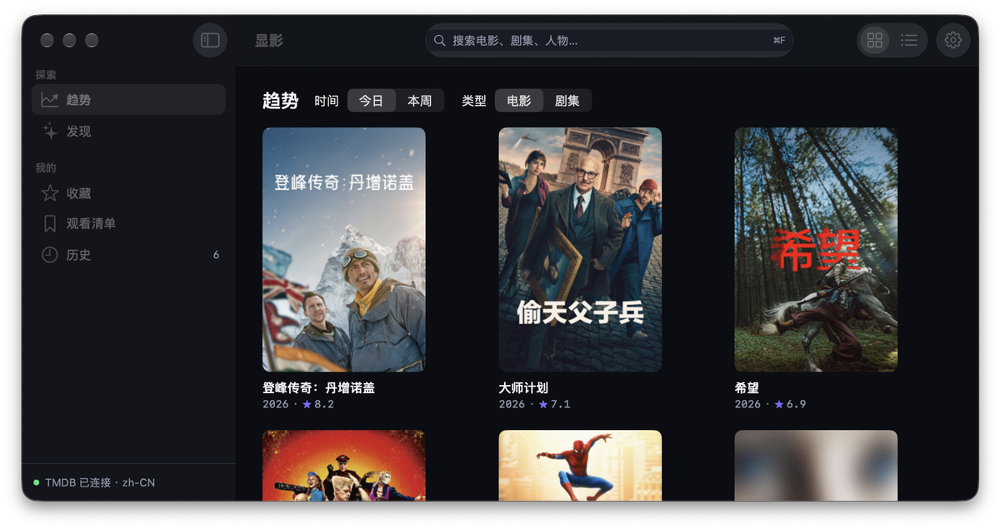
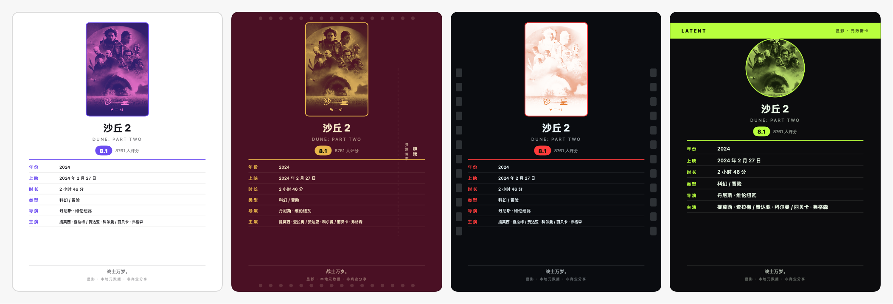
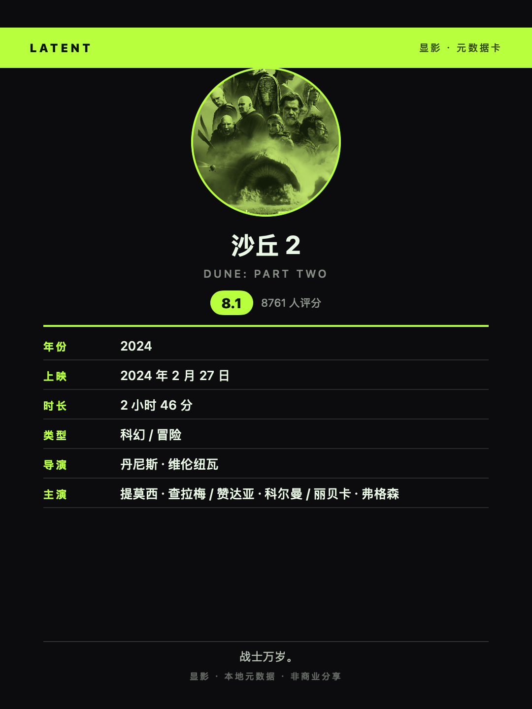

# 显影（Latent）

macOS 上的 TMDB 元数据浏览器：搜索电影、剧集与人物，浏览趋势与筛选发现，收藏并管理自己的观看清单，还能把作品与影人排成一张票据风格的**分享卡**，或把收藏 / 清单排成一张**片单卡**。

> 「显影」取意暗房工艺：影像在显影液里从无到有、缓缓浮现——这个应用让作品背后的信息同样浮现。英文名「Latent」指潜影（latent image）：信息一直都在，只待显现。



## 软件特色

### 影迷的元数据工作台

- **浏览趋势**：今日 / 本周 × 电影 / 剧集，网格与列表两种视图，滚到底自动加载下一页。
- **全局搜索**：工具栏一键搜索（`⌘F`），输入停顿 300ms 才发请求，结果按电影 / 剧集 / 人物分组；记着最近搜过什么。输入拼音或首字母时，顶上先给一组**本地片库**结果——断网也查得到自己的收藏。
- **筛选发现**：按类型多选、年份区间、最低评分与排序条件，随时筛出「今晚看什么」。
- **「来一部」**：趋势或筛选结果里点一下「来一部」，从当前列表随机打开一部，连点两次不重样。
- **完整详情**：Hero 大图、可折叠简介、演职员、剧照、相似与推荐；剧集带季选择器与逐集明细；人物页有生卒年与作品年表。
- **在哪看**：有数据的电影 / 剧集会列出**在线看 / 租借 / 购买**平台；默认中国大陆优先，菜单可切地区，没有渠道的地区自动跳过。

### 自己的片库，只存在本机

- **收藏 / 观看清单 / 历史**三份清单，数据保存在本机数据库，不联网、不上云。
- **批量整理**：收藏 / 观看清单点「选择」多选，批量移出或移到另一清单；支持 ⇧ 区间选择与 `⌘Z` 撤销。单条右键移出 / 移动同样可撤销。
- 列表里右键即可管理；加入或移出时右下角给一句轻提示。

### 一张能发朋友圈的分享卡

电影 / 剧集 / 人物详情页点工具栏的「分享卡」，把作品或影人的元数据排成一张 3:4 的竖版卡片（导出 **1080×1440** PNG）：

- **七款票据风格**：热敏小票、电影票根、暗房底片、铅字报头、账本发票、现代票据、咖啡杯贴，每款都有独立的排版与装饰（齿孔、片孔、报头双线、圆章、顶部色带……）。
- **海报是主视觉**：海报按风格做双色调 / 灰度 / 反相 / 圆形裁切处理，也可切到**保留封面原色**直接印封面；配色除七款锁定风格外，还可选**卡片配色取自封面**——从封面提取主色 + 辅色重算整卡配色（自动保证文字可读）。
- **按类型换字段**：电影印年份 / 上映 / 时长 / 导演，剧集印首播 / 季数 / 集数 / 主创，人物印生卒 / 出生地 / 领域 / 代表作。
- **不编数据**：缺哪项就少哪行——没有预算就不印「预算」。
- **一键拿走**：复制到剪贴板直接粘贴，走系统分享菜单发出去，或存成 PNG。
- **片单卡**：收藏 / 观看清单页点「片单卡」，勾选最多 12 部、改标题，生成 1–12 部自适应网格的 3:4 卡；复用七款调色板与「保留封面原色」，同样支持复制 / 系统分享 / 保存。

### 融进 macOS 的工作流

- **Spotlight 与快捷指令**：收藏与清单会写入 Spotlight，系统搜索框里直接搜得到；配了 Shortcuts 动作——搜索作品、打开作品、按 TMDB ID 打开、打开搜索页。
- **数据出口**：收藏 / 观看清单 / 历史 / 整个片库都能导出 JSON 或 Markdown，落到本地文件。
- **暗 / 浅双主题**：默认跟随系统，全应用两种主题都有照顾；开启「减弱动态效果」后动效自动降级。
- **中英切换**：元数据默认中文，可切英文。

### 克制、干净

- 海报是界面上唯一的大色块，全局只保留一个强调色；动效克制、无粒子无玻璃。
- 纯元数据只读：**不播放任何内容**（正片、预告片都不放）。
- 无账号、无遥测、无后端；只连 TMDB 官方接口。

## 使用方法

### 1. 准备一枚 TMDB Token

首次启动会要求粘贴你的 TMDB **Read Access Token**：

1. 打开 [TMDB 设置 → API](https://www.themoviedb.org/settings/api)，申请或复制一串 **API Read Access Token（v4 auth）**；
2. 粘贴进显影的引导页，点验证；通过后即可开始浏览。

Token 只保存在本机钥匙串，不写日志、不进数据库、不入库。

### 2. 逛一逛

- 左侧边栏「探索」下有**趋势**与**发现**；「我的」下面是**收藏 / 观看清单 / 历史**。
- 顶部搜索框（`⌘F`）搜电影、剧集、人物；右侧可在**网格 / 列表**间切换，最右是设置。
- 趋势 / 发现页标题栏右侧有**「来一部」**，从当前列表随机挑一部打开。
- 点任意一张卡片进入详情；详情里右键或工具栏可收藏、加清单。
- 电影 / 剧集详情往下有**「在哪看」**：按在线看 / 租借 / 购买列出平台，标题旁可切换地区；没有数据时整段不显示。

### 3. 收藏与整理

- 详情页工具栏：**收藏**（`⌘D`）、**观看清单**（`⇧⌘D`），再点一次即移出。
- 库列表标题栏有**筛选框**：中文、英文、拼音全拼（`liulangdiqiu`）或首字母（`lldq`）都认；只筛当前列表，计数显示「命中 / 总数」，切换清单自动清空。
- 库列表点标题栏的**「选择」**进入多选：点按勾选，`⇧`-点按选连续区间，`⌘`-点按可直接进入并勾选；选择栏可全选、移到另一清单或移出当前清单，`⌘Z` 撤销。
- 库列表里右键可管理单条：移出当前清单、移到另一清单；单条操作同样可用 `⌘Z` 撤销。导出去「文件」菜单选 JSON / Markdown。

### 4. 做一张分享卡

1. 进入一部**电影 / 剧集**或一位**影人**的详情页；
2. 点工具栏的**「分享卡」**按钮（剧集与人物在详情加载完成后出现）；
3. 右侧挑风格，左侧勾选是否**保留封面原色**、是否让**卡片配色取自封面**（两个开关独立、默认关），预览实时更新；
4. 点**「复制到剪贴板」**去微信/朋友圈粘贴，点**「分享…」**走系统分享菜单（微信 / 备忘录 / AirDrop），或**「保存 PNG…」**落盘。

### 5. 做一张片单卡

1. 进入**收藏**或**观看清单**；
2. 点标题栏的**「片单卡」**按钮；
3. 右侧改标题、滚动勾选最多 12 部作品（默认预选当前排序的前 12 部；列表为空会提示先收藏），挑风格，可开**保留封面原色**；
4. 点**「复制到剪贴板」**、**「分享…」**或**「保存 PNG…」**。卡片顺序跟随列表当前排序。

### 6. 设置

按 `⌘,` 打开设置：

| 项目 | 用途 |
|---|---|
| Token | 验证 / 重新填写 TMDB Read Access Token |
| 语言 | 中文（zh-CN）/ 英文（en-US） |
| 外观 | 跟随系统 / 浅色 / 深色 |
| 网络 · 代理 | 跟随系统（默认）/ 手动填 HTTP(S) 或 SOCKS5 主机与端口 |
| 缓存 | 查看占用、一键清理 |

## 快捷键

| 快捷键 | 作用 |
|---|---|
| `⌘F` | 聚焦搜索 |
| `⌘R` | 刷新当前页 |
| `⌘[` | 返回上一页 |
| `⌘1` – `⌘6` | 趋势 / 发现 / 收藏 / 观看清单 / 历史 / 统计 |
| `⌘D` | 收藏当前作品（再按一次移出） |
| `⇧⌘D` | 加入 / 移出观看清单 |
| `⌘,` | 打开设置 |
| `↑` `↓` `↵` | 网格 / 列表中移动焦点、打开 |
| `Esc` | 清空搜索或返回；多选中退出 |
| `⌘A` | 多选全选 |
| `⌫` | 多选中移出当前清单 |
| `⌘Z` | 撤销最近一次片库移出 / 移动（单条或批量） |

## 图片展示

**分享卡风格**（同一部电影、同一张海报；共七款，下图示例四款：热敏小票 / 电影票根 / 暗房底片 / 咖啡杯贴）



**单张细节**：咖啡杯贴（碳黑底 + 杨绿强调、圆形封面、顶部色带）



## 系统要求与构建

- **macOS 27 或更高**——应用按最新系统能力编写，不写向下兼容分支。
- 纯 **Swift + SwiftUI**，**0 第三方依赖**（不含开发期工具）；Swift 6 严格并发，数据本地 SwiftData，不启用 CloudKit / iCloud。
- `Latent.xcodeproj` **不入库**，由 [XcodeGen](https://github.com/yonaskolb/XcodeGen) 从 `project.yml` 生成——改动 `project.yml` 或新增源文件后都要重新生成。

```bash
brew install xcodegen          # 只需一次
xcodegen generate              # 生成 Latent.xcodeproj

# 构建
xcodebuild -project Latent.xcodeproj -scheme Latent -configuration Debug build

# 测试（Swift Testing + 内存 ModelContainer + URLProtocol stub）
xcodebuild test -project Latent.xcodeproj -scheme Latent
```

分发定位为自用：不做公证与上架，但 App Sandbox 与 Hardened Runtime 照常配置。首次运行需自备 TMDB Read Access Token（见上文）。

## 版本进展

| 版本 | 内容 |
|---|---|
| v1.0 | P0–P4：趋势 / 搜索 / 发现、详情（含剧集分集与人物）、收藏 / 观看清单 / 历史、设置与缓存 |
| v1.1 | Spotlight 索引与快捷指令、JSON / Markdown 导出 |
| v1.2 | 票据分享卡：七款风格 + 「保留封面原色」「卡片配色取自封面」两个开关 |
| v1.3 | 分享卡扩展到剧集与人物（三类共用同一卡面与管线） |
| v1.4 | 「来一部」随机发现；分享卡走系统分享菜单 |
| v1.5 | 「在哪看」观看平台，分地区在线看 / 租借 / 购买 |
| v1.6 | 片单分享卡（1–12 部自适应网格） |
| v1.7 | 片库多选与批量整理，`⌘Z` / 内联撤销 |
| v1.8 | 拼音搜索：片库筛选框 + 全局搜索「片库」结果组（纯本地，断网可用） |
| v1.9 | 片库详情富化（类型 / 时长 / 导演 / 主演 / 国家）+ 本地统计页（年代 / 评分 / 入库趋势 / Top 榜，`⌘6`） |
| v1.10 | 统计页延伸：预算 vs 票房散点图（回本线）+ 观影护照世界地图，国家榜单显示中文名 |
| v1.11 | 收藏时间轴与八维类型雷达图（Canvas 自绘） |
| v1.11.1 | 修复观影护照地图：恢复平移 / 缩放，视野按已点亮国家自动拟合 |
| v1.12 | 口味画像（偏爱类型 / 最常看年代 / 平均分）+ 加权随机「按口味来一部」 |
| v1.13 | 冷门指数（Schema V3 记录评分人数）与海报色板墙 |
| v1.13.1 | 统计页卡片等高；观影护照地图按标注点拟合视野，不再默认停在非洲 |

## 常见问题

- **国内直连不通**：`设置（⌘,）→ 网络 → 代理`选「手动」，填 HTTP(S) 或 SOCKS5 的主机与端口（如 `127.0.0.1:7890`），改完点「重新验证」。首次启动若 shell 里有 `https_proxy`，会**自动预填**一次（从 Finder 双击启动读不到环境变量）。
- **弹出钥匙串授权对话框**：Keychain 条目按代码签名设 ACL。首次切换签名后读取 Token 可能弹一次「想要使用您存储在钥匙串中的机密信息」——选「始终允许」即可。若对话框被误关，钥匙串操作会一直阻塞，可在「活动监视器」结束 `SecurityAgent` 后重试。

## 更多

完整设计（目标与约束、TMDB API 设计、架构、图片管线、UI 设计系统、里程碑与验收）见 [`docs/设计文档.md`](docs/设计文档.md)。

## 许可与署名

本仓库为个人项目，暂未附开源许可证；代码可供参考，转载或复用请先联系作者。

This product uses the TMDB API but is not endorsed or certified by TMDB.
